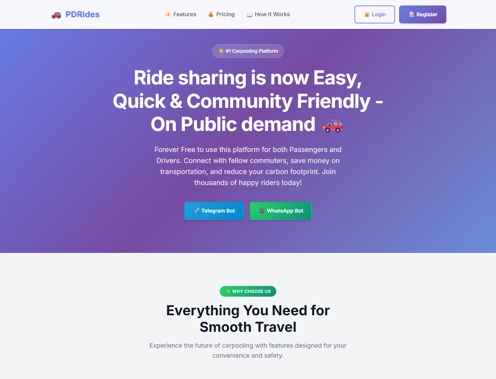

# PDRides

**Public-Demand Ride-share Made Easy**

PDRides is a community ride-sharing web application that connects passengers and drivers through a browser interface and messaging integrations. The project brings together ride discovery, driver ride offers, seat booking, route planning, estimated fares, account settings, and advertising configuration. Its product goal is a platform with no platform fees for passengers or drivers.



*Actual project home page captured locally. Marketing statements displayed in the interface are product copy, not independently verified usage or service guarantees.*

[Source code](https://github.com/vams2krish/PDRides) · [Report an issue](https://github.com/vams2krish/PDRides/issues)

## Project overview

Drivers can publish trips with pickup and destination details, timing, available seats, and a contribution amount. Passengers can discover rides and use booking flows. Map services supply location search, routing, distance, and fare estimates. WhatsApp supports messaging and phone verification; Telegram webhook and bot service modules are also included. MongoDB stores users, rides, conversations, and advertisements.

This repository is an application prototype with implemented backend routes and frontend screens. Messaging requires configured provider accounts, and the instant booking flow currently assigns a mock driver. A screenshot or a successful server start does not establish that all integrations are working in production.

## Features and implementation

| Area | Included in the codebase |
| --- | --- |
| Ride discovery | Browse rides, filter by trip details, view shared ride pages, and see seat availability |
| Driver tools | Publish and manage ride offers with vehicle/profile information |
| Passenger tools | Book seats, cancel bookings, and review ride history |
| Maps | Leaflet interface, OpenStreetMap tiles, Nominatim location lookup, and OSRM routing |
| Fare estimates | Distance/time calculations, ride-type pricing, and detailed fare breakdowns |
| Accounts | WhatsApp OTP flows, registration, sessions, profile and driver settings |
| Preferences | Favorite routes, recent searches, privacy and notification settings |
| Messaging | WhatsApp Cloud API service/webhook and Telegram bot service/webhook |
| Advertising | Ad models, API routes, placement configuration, geographic targeting, and fallback content |
| Maintenance | Scheduled ride expiration and completion tasks; application/database health routes |

## Technology

- **Frontend:** HTML, CSS, browser JavaScript, and Leaflet.
- **Backend:** Node.js with ECMAScript modules and Express 4.
- **Persistence:** MongoDB, Mongoose 8, and the MongoDB Node.js driver 7.
- **Integrations:** WhatsApp Cloud API, Telegram Bot API, Nominatim, and OSRM.
- **Utilities:** Axios, dotenv, node-cron, and nodemon for development.

## Local setup

### Prerequisites

- Node.js **20.19 or newer**, matching the minimum required by the declared MongoDB 7 driver dependency.
- npm and a reachable MongoDB instance, locally or hosted.
- A Meta WhatsApp Cloud API application for WhatsApp delivery and OTP testing.
- A Telegram bot token if testing Telegram integration.

### Install and configure

```bash
git clone https://github.com/vams2krish/PDRides.git
cd PDRides
npm install
```

Copy the environment template:

```powershell
# PowerShell
Copy-Item .env.example .env
```

```bash
# macOS / Linux
cp .env.example .env
```

Edit `.env` with your own configuration. Use the same port in `PORT` and `WEB_APP_URL`; the template currently has different values. A consistent local example is:

```dotenv
PORT=3000
NODE_ENV=development
APP_NAME=PDRides
MONGODB_URI=mongodb://localhost:27017/pdrides
WEB_APP_URL=http://localhost:3000
WHATSAPP_PHONE_NUMBER_ID=your_phone_number_id
WHATSAPP_ACCESS_TOKEN=your_access_token
WHATSAPP_WEBHOOK_VERIFY_TOKEN=your_verification_token
TELEGRAM_BOT_TOKEN=your_bot_token
TELEGRAM_WEBHOOK_SECRET=your_webhook_secret
MAX_RIDE_RESULTS=5
```

| Variable | Purpose |
| --- | --- |
| `PORT` | HTTP port; the server falls back to `3002` when unset |
| `MONGODB_URI` | Database connection; `MONGO_URI` and `MONGODB_URL` are fallback aliases |
| `MONGODB_DATABASE` | Optional database name; defaults to `pdrides` |
| `WEB_APP_URL` | Base URL used for links sent in messages |
| `APP_NAME` | Optional display name in server/health output |
| `WHATSAPP_PHONE_NUMBER_ID` | Your Meta WhatsApp phone-number resource ID |
| `WHATSAPP_ACCESS_TOKEN` | Credential for WhatsApp message delivery |
| `WHATSAPP_WEBHOOK_VERIFY_TOKEN` | Value used during webhook verification |
| `WHATSAPP_API_VERSION` | Optional Graph API version override used by the WhatsApp service |
| `TELEGRAM_BOT_TOKEN` | Telegram bot credential |
| `TELEGRAM_WEBHOOK_SECRET` | Telegram webhook configuration secret |
| `MAX_RIDE_RESULTS` | Ride-result configuration from the environment template |

The template also contains `MAPBOX_TOKEN` and `OPENROUTESERVICE_KEY`; the current map service uses Nominatim and OSRM directly. Keep `.env` private and replace the example phone-number ID with your own.

Some integration modules read environment variables during module initialization. If credentials from `.env` are not picked up with `npm start`, preload the file before importing the app:

```bash
node --env-file=.env src/index.js
```

### Run

```bash
npm run dev
# or
npm start
```

The backend connects to MongoDB before opening its HTTP listener. With the configuration above, visit `http://localhost:3000/`.

## Screens and routes

| URL | Screen |
| --- | --- |
| `/` | Home page |
| `/map` | Interactive map and trip planning |
| `/register` | Registration |
| `/login` | Login |
| `/browse-all-rides` | Ride discovery |
| `/my-rides` | Personal rides |
| `/ride/:id` | Shareable ride details |
| `/settings` | Account and preferences |
| `/ads-config` | Advertising configuration interface |
| `/help-center` | Help content |
| `/contact-us` | Contact page |
| `/privacy-policy` | Privacy policy |
| `/terms-of-service` | Terms of service |

The static HTML files are also present at the repository root. Opening only those files does not supply the API or database functionality.

## API overview

| Endpoint or group | Purpose |
| --- | --- |
| `GET /health` | Application liveness |
| `GET /api/health`, `GET /api/ping` | Database-aware health and connectivity |
| `/api/auth/*` | OTP requests, verification, registration, and session operations |
| `/api/user/*` | Profile, vehicle details, preferences, and history |
| `/api/users/me/*` | Unified current-user profile and preferences routes |
| `GET /api/rides`, `POST /api/rides` | Search and create ride offers |
| `/api/rides/:id/*` | Ride booking, cancellation, completion, and status operations |
| `GET /api/fare` | Fare estimates for pickup/destination locations |
| `POST /api/ride/book` | Prototype instant booking with a mock driver |
| `GET /api/route` | Route details |
| `GET /api/autocomplete`, `GET /api/reverse-geocode` | Location lookup |
| `/api/ads*` | Advertisement management and delivery routes |
| `/webhook` | WhatsApp verification and incoming events |
| `/telegram-webhook` | Telegram incoming events |

Consult [the app entry point](src/index.js) and [route modules](src/routes) for request fields and authorization behavior. Some ride and location routes are defined in the entry point before the unified API router; Express handles the first matching route, so overlapping handlers need to be considered when extending the API.

## Messaging setup

**WhatsApp:** Configure your own Meta credentials and verification token, expose the app through an HTTPS URL, and configure the callback at `/webhook`. Subscribe the provider application to the events needed by the webhook handlers. OTP and outgoing-message flows require working provider credentials.

**Telegram:** Configure your own bot token and webhook settings. [set-telegram-webhook.js](set-telegram-webhook.js) is the repository's setup helper; inspect its configuration before running it against a bot. The source includes both Telegram and WhatsApp integrations, but their presence does not confirm a deployed bot is online.

## Repository layout

```text
PDRides/
├── index.html                 # Landing page
├── map-view.html              # Map and trip planning UI
├── browse-rides.html           # Ride discovery UI
├── my-rides.html               # Personal ride UI
├── ride-details.html           # Shared ride UI
├── login.html / register.html  # Account entry screens
├── settings.html               # User preferences
├── ads-config.html             # Advertising UI
├── css/                        # Screen styles
├── src/
│   ├── index.js                # Express app, routes, startup
│   ├── middleware/             # Authentication helpers
│   ├── models/                 # User, Ride, Conversation, Ad
│   ├── routes/                 # Auth, user, API, messaging, ads
│   └── services/               # Database, rides, maps, messaging, scheduling
├── ads-config/                 # Placement, targeting, unit and fallback JSON
├── ads-system/                 # Ad loader and developer configuration
├── docs/images/                # README project screenshot
├── test-*.js / test-*.json      # Manual integration scripts and sample payloads
├── .env.example                # Environment template
└── package.json                # Dependencies and commands
```

## Verification and current limitations

`npm test` is currently a placeholder that exits with an error; there is no automated test suite configured. The `test-*.js` scripts and `test-bot.html` are manual integration aids. Review their endpoints and payloads before running them, since some can send messages or modify records.

For a configured local instance:

```bash
curl http://localhost:3000/health
curl http://localhost:3000/api/health
```

Then exercise registration, an offered ride, ride discovery, booking/cancellation, and the messaging callbacks with test accounts.

Before production use, review authentication and authorization across all routes, OTP handling, CORS, input validation, provider webhook verification, and static file exposure. The app currently serves the repository root as static content, includes permissive demo CORS, and contains mock instant-booking behavior. These are implementation limitations rather than production service guarantees. Advertised live tracking, driver verification, reviews, and user-count claims should be validated against a complete deployed flow before being represented as operational capabilities.

## Contributing

Open an issue with reproduction steps or a proposed improvement. For code changes, describe the affected flow, configuration needs, and how it was verified. Do not include credentials, personal ride data, or production message payloads.

## License

`package.json` declares MIT, but this repository currently has no standalone `LICENSE` file. Confirm the intended license terms with the repository owner before relying on a license grant.
